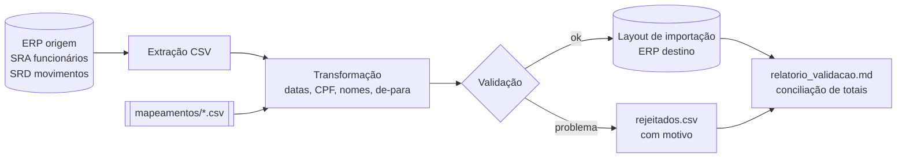

# 🔄 ETL de migração de dados do Departamento Pessoal (ERP → ERP)

Pipeline em Python para **migrar dados de DP** (cadastro de funcionários e histórico de folha) de um ERP antigo para o **layout de importação** de um ERP novo, com **de-para** de campos, verbas, cargos e centros de custo, **validação** (CPF, duplicidades, campos sem correspondência) e **conciliação de valores** antes da carga.

> Inspirado numa migração real de ERP de que participei. **Todos os dados aqui são fictícios**, gerados por script, e os layouts são genéricos (a origem lembra as tabelas SRA/SRD, de funcionários e movimentos, comuns em ERPs nacionais).

## Fluxo



## O que é tratado

| Regra | Exemplo |
|---|---|
| Datas `AAAAMMDD` → `DD/MM/AAAA` | `20260115` → `15/01/2026` |
| CPF só dígitos → validado e formatado | `52998224725` → `529.982.247-25` (dígito verificador conferido) |
| Nome padronizado | `ana  silva` → `ANA SILVA` |
| Situação da folha | `' '`→ATIVO, `A`→AFASTADO, `F`→FÉRIAS, `D`→DESLIGADO |
| De-para de verbas, cargos e centros de custo | `101` → `0001 Salário base` |
| Rejeição com motivo | CPF inválido, matrícula duplicada, código sem de-para |
| Conciliação | soma dos valores da origem = migrado + rejeitado |

## Exemplo de relatório gerado

```text
| Item         | Origem | Migrado | Rejeitado |
| Funcionários |     61 |      58 |         3 |
| Movimentos   |    408 |     394 |        14 |

Conciliação de valores: origem R$ 1.135.224,60 · migrado + rejeitado R$ 1.135.224,60 · ✅ confere
```

## Como rodar

```bash
pip install -r requirements.txt
python -m etl.gerar_dados_ficticios   # cria dados/origem/*.csv (com erros plantados de propósito)
python -m etl.transformar             # gera dados/destino/ + relatorio_validacao.md
pytest
```

## Aprendizados de uma migração real

- O **de-para** é o coração do projeto: precisa ser validado com o RH/contabilidade antes de qualquer carga.
- **Nunca descartar registro em silêncio:** tudo o que não migra vai para o arquivo de rejeitados com o motivo.
- **Conciliar valores por competência** dá segurança para a área de negócio aprovar a virada.
- Rodar a carga primeiro em **homologação** e comparar holerites por amostragem.

## Tecnologias

Python · pandas · ETL · qualidade de dados · pytest
